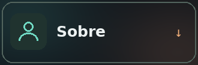
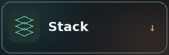
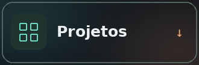
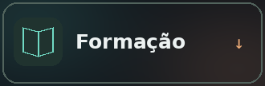
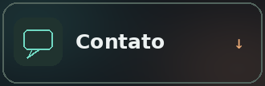
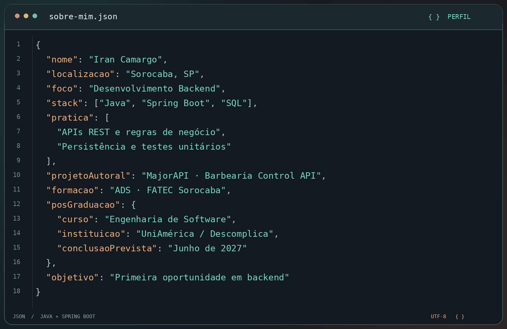

 

  

 

## Sobre mim

 

 

## Stack & ferramentas

 

| Área | Tecnologias e práticas |
| :--- | :--- |
| ☕ Backend | Java · Spring Boot · Maven · APIs REST |
| 🧩 Contratos e regras | DTOs · Mappers · Bean Validation · Tratamento de exceções |
| 🗃️ Persistência | JPA/Hibernate · H2 · SQL |
| 🧪 Qualidade | JUnit · Mockito |
| 🛠️ Ferramentas | IntelliJ IDEA · Postman · Git/GitHub |

＋ Tecnologias utilizadas em projetos acadêmicos

 

`C#/.NET` `Next.js` `React Native` `TypeScript` `Python/FastAPI`

`AWS Amplify` `Cognito` `DynamoDB` `S3`

 

## Projetos selecionados

### 💈 MajorAPI · Barbearia Control API

PROJETO AUTORAL &nbsp; / &nbsp; BACKEND &nbsp; / &nbsp; NEGÓCIO REAL

  

API REST desenvolvida a partir das necessidades de uma barbearia real, com evolução incremental e decisões documentadas.

- Cadastro, listagem, consulta por ID, edição e inativação de serviços.
- Validação de dados e controle de nomes duplicados entre serviços ativos.
- DTOs, tratamento global de exceções e respostas padronizadas.
- Testes unitários e preservação dos registros por inativação lógica.

> ✅ Módulo Services concluído.
>
> 🔨 Registro de atendimentos em desenvolvimento.

`Java` `Spring Boot` `JPA/Hibernate` `H2` `Bean Validation` `JUnit` `Mockito`

 

<a href="https://github.com/IranFatec2108/MajorAPI"><kbd> 📂 Explorar repositório ↗ </kbd></a>
&nbsp;&nbsp;
<a href="https://github.com/IranFatec2108/MajorAPI/commits"><kbd> ↻ Acompanhar evolução </kbd></a>

  

### Outras construções

 

### ◈ ASAC · Acessibilidade e aprendizado

PROJETO EM EQUIPE &nbsp; / &nbsp; APLICATIVO EDUCACIONAL &nbsp; / &nbsp; EM USO PELA INSTITUIÇÃO

  

Aplicativo de apoio ao aprendizado de Braille, desenvolvido como TCC para a Associação Sorocabana de Atividades para Deficientes Visuais.

Contribuí no frontend, na documentação e em configurações dos serviços de backend. O projeto reúne recursos de contraste, áudio e integração com leitores de tela.

`React Native` `TypeScript` `AWS Amplify` `Cognito` `DynamoDB` `S3`

 

<a href="https://github.com/IranFatec2108/ASAC"><kbd> 📂 Conhecer ASAC ↗ </kbd></a>

 

---

### ⇄ HoldCrypto · Aplicações conectadas

PROJETO EM EQUIPE &nbsp; / &nbsp; WEB & MOBILE &nbsp; / &nbsp; INTEGRAÇÃO DE SERVIÇOS

  

Plataforma acadêmica de simulação de negociação de criptomoedas, com aplicações web e mobile integradas a serviços de backend.

Atuei no aplicativo mobile com autenticação, saldo e transações. Também contribuí no frontend web, integração com APIs, ajustes de regras de negócio, chatbot em Python e documentação técnica.

`C#/.NET` `Next.js` `React Native` `FastAPI` `Ocelot` `SQLite`

 

<a href="https://github.com/IranFatec2108/AMS_HoldCrypto"><kbd> 📂 Conhecer HoldCrypto ↗ </kbd></a>

 

---

### ⌁ Cadastro de Ninjas · Fundamentos em prática

JAVA10X &nbsp; / &nbsp; API REST &nbsp; / &nbsp; JAVA + SPRING BOOT

  

API desenvolvida durante o curso Java10x, com operações de cadastro, consulta, atualização e exclusão.

Prática de organização em camadas, injeção de dependências, DTOs, mappers e transformação de coleções com Streams.

`Java` `Spring Boot` `JPA` `H2`

 

<a href="https://github.com/IranFatec2108/CadastroDeNinjas"><kbd> 📂 Conhecer projeto ↗ </kbd></a>

 

## Formação & evolução

🎓 Pós-graduação em Engenharia de Software  
UniAmérica / Descomplica · Conclusão prevista: junho de 2027.

🎓 Graduação em Análise e Desenvolvimento de Sistemas  
FATEC Sorocaba · Concluída.

 

＋ O que estou aprofundando atualmente

 

`Backend Java` `SQL` `Testes unitários` `Fundamentos de frontend` `Deploy`

  

 

Aberto a oportunidades de desenvolvimento backend.

  

<a href="https://www.linkedin.com/in/iran-camargo"><kbd> 💼 LinkedIn ↗ </kbd></a>
&nbsp;&nbsp;
<a href="https://wa.me/5515981293708"><kbd> 💬 WhatsApp ↗ </kbd></a>
&nbsp;&nbsp;
<a href="https://github.com/IranFatec2108?tab=repositories"><kbd> 📂 Repositórios ↗ </kbd></a>

  

SOROCABA, SP &nbsp; · &nbsp; DESENVOLVIMENTO BACKEND

