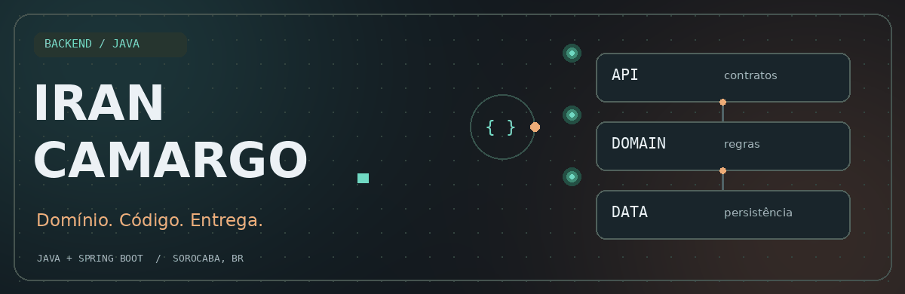
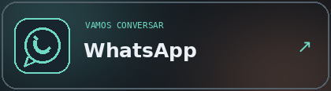
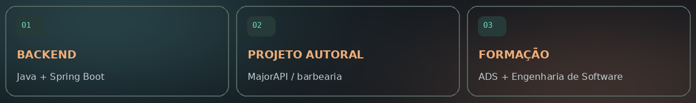
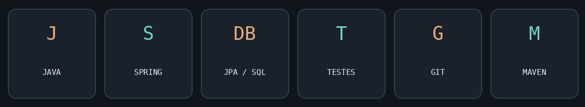
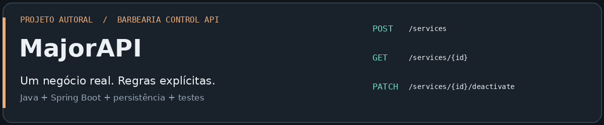
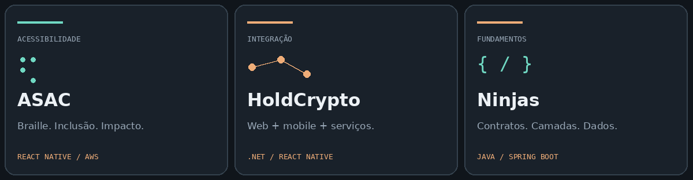
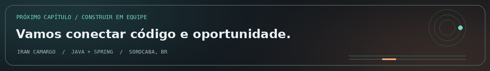

 

  

`APIs REST` &nbsp; · &nbsp; `REGRAS DE NEGÓCIO` &nbsp; · &nbsp; `PERSISTÊNCIA` &nbsp; · &nbsp; `TESTES`

 

<a href="#sobre"><kbd> ◉ <strong>SOBRE</strong> </kbd></a>
&nbsp;
<a href="#stack"><kbd> ⌘ <strong>STACK</strong> </kbd></a>
&nbsp;
<a href="#projetos"><kbd> ▣ <strong>PROJETOS</strong> </kbd></a>
&nbsp;
<a href="#formacao"><kbd> ◇ <strong>FORMAÇÃO</strong> </kbd></a>
&nbsp;
<a href="#contato"><kbd> ↗ <strong>CONTATO</strong> </kbd></a>

 

---

## ◉ Sobre mim
01 / PESSOA, CONTEXTO E DIREÇÃO

### Entender o negócio. Construir a solução.

Sou Iran Camargo, formado em Análise e Desenvolvimento de Sistemas pela FATEC Sorocaba e pós-graduando em Engenharia de Software pela UniAmérica / Descomplica.

Meu foco é backend com Java e Spring Boot: construir APIs REST, modelar regras de negócio e trabalhar com persistência e testes.

 

 

<table>
<tr>
<td width="50%" valign="top">

### 💈 Construindo agora

A <strong>MajorAPI</strong>, um projeto autoral que transforma necessidades de uma barbearia real em funcionalidades, com desenvolvimento incremental e decisões documentadas.

</td>
<td width="50%" valign="top">

### 🤝 Experiência em equipe

Participação em projetos com aplicações web, mobile, acessibilidade e serviços AWS, conectando desenvolvimento e necessidades reais.

</td>
</tr>
</table>

> 🎯 <strong>Meu próximo passo</strong>
>
> Busco minha primeira oportunidade profissional em desenvolvimento backend para contribuir com projetos e evoluir junto a uma equipe.

 

---

## ⌘ Stack & ferramentas
02 / MINHA BANCADA DE DESENVOLVIMENTO

 

 

| Área | Tecnologias e práticas |
| :--- | :--- |
| ☕ <strong>Backend</strong> | Java · Spring Boot · Maven · APIs REST |
| 🧩 <strong>Contratos e regras</strong> | DTOs · Mappers · Bean Validation · Tratamento de exceções |
| 🗃️ <strong>Persistência</strong> | JPA/Hibernate · H2 · SQL |
| 🧪 <strong>Qualidade</strong> | JUnit · Mockito |
| 🛠️ <strong>Ferramentas</strong> | IntelliJ IDEA · Postman · Git/GitHub |

<strong>＋ Tecnologias utilizadas em projetos acadêmicos</strong>

 

`C#/.NET` `Next.js` `React Native` `TypeScript` `Python/FastAPI`

`AWS Amplify` `Cognito` `DynamoDB` `S3`

 

---

## ▣ Projetos selecionados
03 / DO REQUISITO À ENTREGA

 

### 💈 MajorAPI
#### Barbearia Control API

`PROJETO AUTORAL` &nbsp; `BACKEND` &nbsp; `NEGÓCIO REAL`

 

 

API REST para apoiar o controle interno de uma barbearia, com requisitos definidos a partir das necessidades do proprietário e evolução incremental por módulos.

> ✅ <strong>Entrega atual</strong> · Módulo Services concluído
>
> 🔨 <strong>Em desenvolvimento</strong> · Registro de atendimentos

<table>
<tr>
<td width="50%" valign="top">

#### Funcionalidades

- Cadastro, listagem e consulta por ID.
- Edição e inativação de serviços.
- Controle de nomes duplicados entre serviços ativos.
- Preservação dos registros por inativação lógica.

</td>
<td width="50%" valign="top">

#### Construção técnica

- DTOs e validação de entrada.
- Tratamento global de exceções.
- Respostas de erro padronizadas.
- Testes unitários e decisões documentadas.

</td>
</tr>
</table>

`Java` `Spring Boot` `JPA/Hibernate` `H2` `Bean Validation` `JUnit` `Mockito`

 

<table>
<tr>
<td align="center" width="50%">
 
<a href="https://github.com/IranFatec2108/MajorAPI">
<strong>📂 EXPLORAR MAJORAPI ↗</strong>
</a>
  
Código e apresentação do projeto
  
</td>
<td align="center" width="50%">
 
<a href="https://github.com/IranFatec2108/MajorAPI/commits">
<strong>↻ ACOMPANHAR EVOLUÇÃO ↗</strong>
</a>
  
Implementações e histórico de alterações
  
</td>
</tr>
</table>

  

### Outras construções
EXPERIÊNCIA COLABORATIVA / ACESSIBILIDADE / INTEGRAÇÃO / APRENDIZADO

  

  

### ◈ ASAC
#### Tecnologia com impacto social

`TCC EM EQUIPE` &nbsp; `ACESSIBILIDADE` &nbsp; `EM USO PELA INSTITUIÇÃO`

Aplicativo educacional de Braille desenvolvido para a Associação Sorocabana de Atividades para Deficientes Visuais.

<strong>Minha contribuição</strong>

Frontend, documentação e apoio em configurações dos serviços de backend. O projeto reúne recursos de contraste, áudio e integração com leitores de tela.

`React Native` `TypeScript` `AWS Amplify` `Cognito` `DynamoDB` `S3`

 

<table>
<tr>
<td width="100%">
 
&nbsp; <a href="https://github.com/IranFatec2108/ASAC"><strong>📂 CONHECER O PROJETO ASAC ↗</strong></a>
  
&nbsp; Acessibilidade, desenvolvimento mobile e trabalho em equipe
  
</td>
</tr>
</table>

 

---

### ⇄ HoldCrypto
#### Aplicações conectadas

`PROJETO EM EQUIPE` &nbsp; `WEB & MOBILE` &nbsp; `INTEGRAÇÃO`

Plataforma acadêmica de simulação de negociação de criptomoedas, com aplicações web e mobile integradas a serviços de backend.

<strong>Minha contribuição</strong>

Aplicativo mobile com autenticação, saldo e transações, além de frontend web, integração com APIs, ajustes de regras de negócio, chatbot em Python e documentação técnica.

`C#/.NET` `Next.js` `React Native` `FastAPI` `Ocelot` `SQLite`

 

<table>
<tr>
<td width="100%">
 
&nbsp; <a href="https://github.com/IranFatec2108/AMS_HoldCrypto"><strong>📂 EXPLORAR HOLDCRYPTO ↗</strong></a>
  
&nbsp; Aplicações web e mobile, APIs e integração entre serviços
  
</td>
</tr>
</table>

 

---

### ⌁ Cadastro de Ninjas
#### Fundamentos backend em prática

`JAVA10X` &nbsp; `API REST` &nbsp; `JAVA + SPRING`

API desenvolvida durante o curso Java10x, com operações de cadastro, consulta, atualização e exclusão.

<strong>Prática técnica</strong>

Organização em camadas, injeção de dependências, DTOs, mappers e transformação de coleções com Streams.

`Java` `Spring Boot` `JPA` `H2`

 

<table>
<tr>
<td width="100%">
 
&nbsp; <a href="https://github.com/IranFatec2108/CadastroDeNinjas"><strong>📂 EXPLORAR CADASTRO DE NINJAS ↗</strong></a>
  
&nbsp; Java, Spring Boot e fundamentos de construção de APIs
  
</td>
</tr>
</table>

 

---

## ◇ Formação & evolução
04 / BASE TÉCNICA E APRENDIZADO CONTÍNUO

 

| 🎓 Formação | Instituição | Etapa |
| :--- | :--- | :--- |
| Engenharia de Software · Pós-graduação | UniAmérica / Descomplica | Conclusão prevista: jun/2027 |
| Análise e Desenvolvimento de Sistemas · Graduação | FATEC Sorocaba | Concluída |

> 📚 <strong>Em aprofundamento</strong>
>
> Backend Java · SQL · Testes unitários · Fundamentos de frontend · Deploy

 

---

05 / PRÓXIMO CAPÍTULO

## 🤝 Vamos construir em equipe?

### Aberto a oportunidades de desenvolvimento backend.

Vamos conversar sobre projetos, tecnologia e oportunidades.

 

<table>
<tr>
<td align="center" width="50%">
 
<a href="https://www.linkedin.com/in/iran-camargo"><strong>💼 CONECTAR NO LINKEDIN ↗</strong></a>
  
Trajetória profissional e oportunidades
  
</td>
<td align="center" width="50%">
 
<a href="https://wa.me/5515981293708"><strong>💬 CONVERSAR NO WHATSAPP ↗</strong></a>
  
Contato direto para uma conversa
  
</td>
</tr>
</table>

 

<a href="https://github.com/IranFatec2108?tab=repositories"><kbd> 📂 <strong> EXPLORAR MAIS PROJETOS ↗ </strong> </kbd></a>

  

  

<a href="#sobre"><strong>↑ VOLTAR À APRESENTAÇÃO</strong></a>

